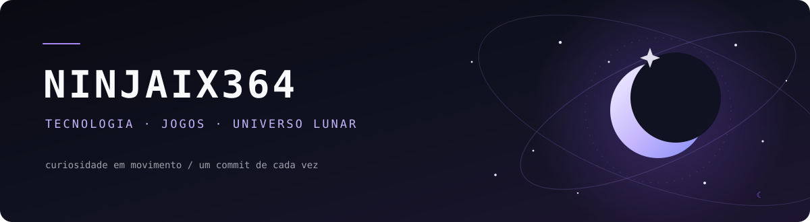

<div align="center">
  
  <br />
  <p><samp>aprendendo, criando e evoluindo — um commit de cada vez</samp></p>
  <p>
    <a href="https://github.com/ninjaix364">
      
    </a>
    
    
  </p>
</div>

---

## `sobre_mim` ☾

<a href="https://gifs.alphacoders.com/gifs/view/219797"></a>

Sou uma pessoa desenvolvedora em constante evolução: aprendo na prática, quebro a cabeça com alguns bugs e tento entender o *porquê* das coisas — não apenas fazer funcionar.

Gosto de transformar ideias em projetos reais, organizar interfaces, conectar telas com lógica e bancos de dados e melhorar o código a cada versão. Este perfil é um pouco de portfólio e um pouco de diário de bordo: reúne o que estou construindo, estudando e descobrindo pelo caminho.

**Minha filosofia:** menos mágica incompreendida, mais curiosidade, tentativa e aprendizado.

<br clear="right" />

## `o_que_estou_criando`

- Interfaces web e componentes reutilizáveis com **React**.
- Aplicações com formulários, operações de cadastro, consulta, edição e exclusão (CRUD) e integração com APIs.
- Projetos para praticar lógica, orientação a objetos e bancos de dados.
- Experimentos que começam pequenos e ganham forma conforme aprendo.

## `ferramentas_e_estudos`

<p>
  
  
  
  
  
  
  
  
</p>

Essa lista não é uma coleção de troféus nem uma afirmação de domínio absoluto. São tecnologias com as quais venho estudando, praticando e aprendendo a trabalhar melhor.

## `fora_do_codigo`

Quando não estou tentando convencer algum código a colaborar, provavelmente estou explorando um mundo virtual, pensando em uma estratégia ou inventando detalhes para algum personagem.

- 🌙 **League of Legends:** Diana na rota do meio tem um lugar especial por aqui.
- ⚔️ **MMORPGs:** gosto de explorar mundos como *Black Desert Online*.
- 🗝️ **RPG e criação de personagens:** histórias, conceitos sombrios, nomes com significado e personagens com personalidade própria.
- 🖤 **Estética:** tons escuros, atmosfera gótica e interfaces limpas — sem precisar colocar neon em tudo.

## `registro_de_bordo`

```text
[em andamento] aprender algo novo
[em andamento] transformar estudo em projeto
[em andamento] deixar o código mais organizado
[sempre]       investigar aquele bug que “não faz sentido”
```

## `meu_github`

<div align="center">
  
  
</div>

---

<div align="center">
  <samp>“Nem toda evolução faz barulho. Algumas acontecem à luz da lua.”</samp>
  <br />
  <sub>feito por Ninjaix</sub>
</div>

